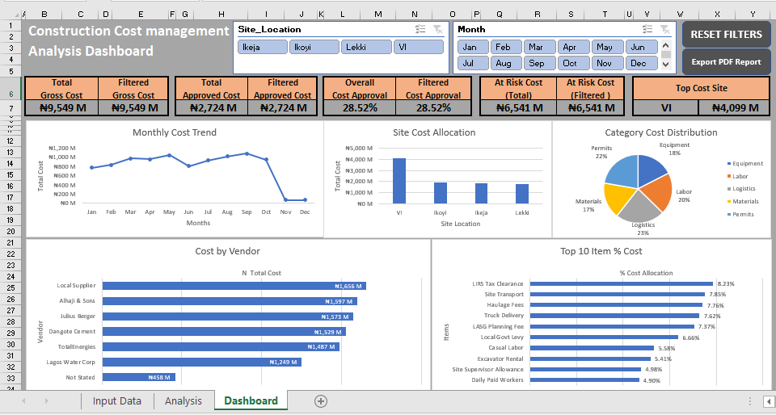
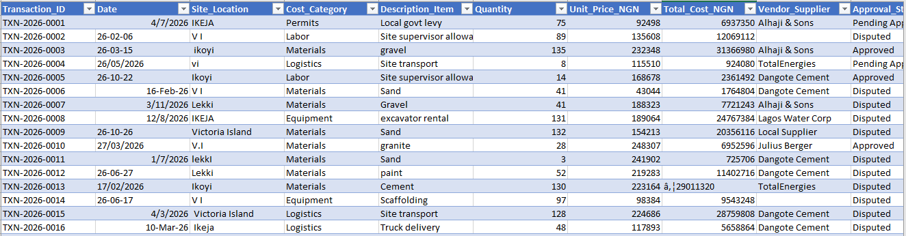
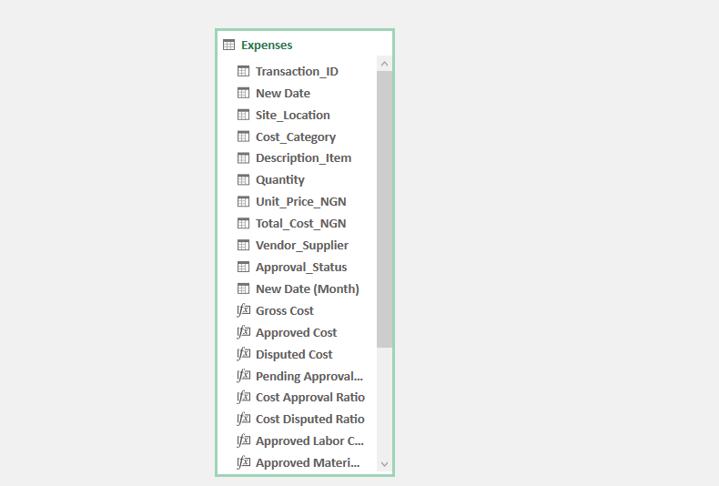
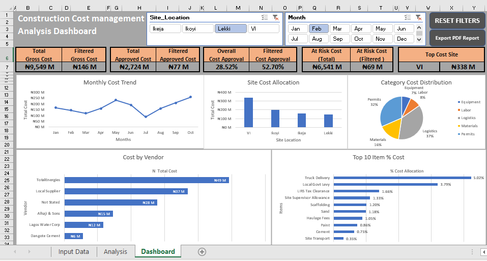
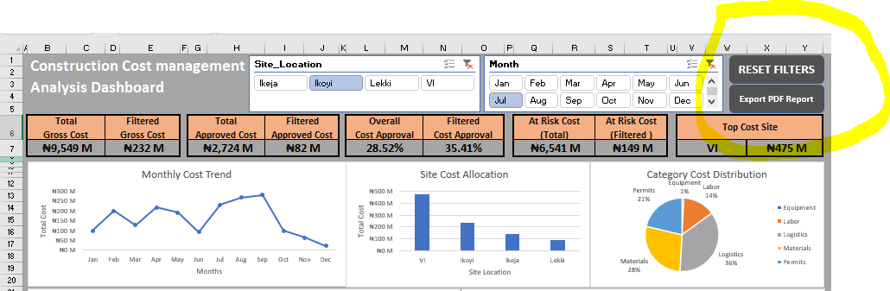

# Construction Cost management Analysis Dashboard

> **Disclaimer:** This is fictitious data that was put together for the purpose of training and portfolio demonstration. All figures, vendor names, transaction IDs, and site costs are simulated and do not represent any real company.

### Overview
An advanced Excel dashboard designed to transform raw, unstructured construction expenses into clear, actionable business insights.

It tracks a simulated portfolio of **₦9,549M** across 4 Lagos sites - VI, Ikoyi, Lekki, Ikeja - with focus on cost control, cash retention, and certification tracking.

**Live KPIs from Dashboard:**
- Total Gross Cost: ₦9,549 M
- Total Approved Cost: ₦2,724 M
- Overall Cost Approval: 28.52%
- At Risk Cost (Total): ₦6,541 M
- Top Cost Site: VI - ₦4,099 M

### 📸 Dashboard Preview

*Construction Cost management Analysis Dashboard - Main View*

### Key Features

#### 1. Raw Data Cleaning & Validation

Source table `Expenses` with columns: Transaction_ID, Date, Site_Location, Cost_Category, Description_Item, Quantity, Unit_Price_NGN, Total_Cost_NGN, Vendor_Supplier, Approval_Status

**Cleaning tasks performed:**
- Standardized Date: Fixed 4 formats (e.g., `4/7/2026`, `26-02-06`, `16-Feb-26`, `3/11/2026`) into single Date + Month field for trending
- Standardized Site_Location: `IKEJA / V I / Ikoyi / vi / Victoria Island / V.I / lekki` → 4 clean values for Slicers
- Cleaned Vendor names, handled "Not Stated", removed duplicates, applied TRIM and Data Validation
- Added calculated columns: Gross Cost, Approved Cost, Disputed Cost, Pending Approval

#### 2. Data Modeling - Power Pivot & DAX

Built on Excel Data Model with 11 base columns + 8 DAX Measures (`fx` icon):
- `Gross Cost`, `Approved Cost`, `Disputed Cost`, `Pending Approval`
- `Cost Approval Ratio`, `Cost Disputed Ratio`
- `At Risk Cost (Total)`, `At Risk Cost (Filtered)`

This enables dynamic calculation of KPI cards without hardcoding.

#### 3. Interactive Dashboard & Visualization
**Pivot Tables, Pivot Charts, Slicers, Conditional Formatting:**

- **Slicers:** Site_Location (Ikeja, Ikoyi, Lekki, VI) and Month (Jan-Dec) - connected to ALL PivotTables via Report Connections
- **Charts:**
    - Monthly Cost Trend (Line Chart)
    - Site Cost Allocation (Column Chart)
    - Category Cost Distribution (Pie Chart - Permits, Labor, Materials, Logistics, Equipment)
    - Cost by Category, Vendor & Top 10 Items

#### 4. Interactivity Proof - Slicers Working

Filtering to Lekki + Feb → Filtered Gross drops to ₦146M, Filtered Approved ₦77M, Approval Rate jumps to 52.70%, proving dynamic cross-filtering.

#### 5. Automation - VBA / Macros

Two VBA buttons built in top-right corner (circled):

**A. RESET FILTERS**
 : Helps to Reset all the Slicers 

**B. EXPORT PDF REPORT**
 : Helps Print Report to PDF 

### Skills Demonstrated

- Pivot Tables, Pivot Charts, Slicers,
 Conditional Formatting 
- VBA / Macros for workflow automation 
- Power Query (data cleaning) & Power Pivot (data modeling) 
-Data Validation & Integrity Checks
- Advanced Excel Formulas (XLOOKUP, INDEX/MATCH, SUMIFS, Nested IF)
- Data Visualization & Dashboard Design Principles 
